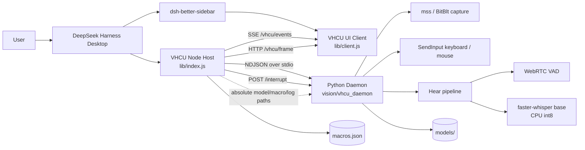

# VHCU

**Vision · Hearing · Computer Use for DeepSeek Harness**  
Local-first screen understanding, system-audio transcription, and safe Windows input automation — exposed as 24 tools and a sidebar panel.

**Repository:** [github.com/qiaozy-16/dsh-vhcu](https://github.com/qiaozy-16/dsh-vhcu)


---

> [!IMPORTANT]
> **Before installing, read this.**
>
> - **Required companion:** this plugin's UI is designed to work with **`dsh-better-sidebar`**. Install and enable it in the same DSH profile first. VHCU will not render a usable panel without a sidebar host.
> - **Windows only — DSH Desktop App only:** screen capture uses Windows GDI/BitBlt, input uses `SendInput`, and Hear uses WASAPI loopback. macOS and Linux are not supported. **仅支持 Windows 系统下的 DSH 桌面版 (Desktop App)，不支持 Web 网页端；浏览器沙盒无法启动本地 Python 或注入键鼠。**
> - **DSH version:** **0.2.1-rc.3 is recommended** (tested profile). The plugin declares compatibility for `0.2.0-rc.2`, `0.2.1-rc.2`, and `0.2.1-rc.3`.
> - **This plugin can control your real mouse and keyboard.** Read the [Safety](#safety) section before using the privacy-shield override or automatic approval of sensitive operations.

---

## What is VHCU?

VHCU is a DeepSeek Harness plugin for **local multimodal computer use**:

- captures the primary screen and turns visual differences into structured events;
- transcribes **system playback audio** (not the microphone) with a local faster-whisper model;
- exposes 24 model-callable tools for observation, clicking, typing, hotkeys, dragging, and macro replay;
- fuses vision and hearing into a single 1.5-second multimodal timeline;
- keeps screenshots, audio, coordinates, and macros on the local machine.

It is intentionally **not** a cloud automation service. The only expected network access is the optional one-time faster-whisper model download.

---

## Feature Highlights

### Multimodal perception

| Capability | Detail |
|---|---|
| Screen capture | `mss` / Windows BitBlt, primary monitor, DPI-aware |
| Visual diff | Lightweight NumPy diff, change-only ROI events, 1 fps idle loop |
| Full frame | Signed local PNG URL with image-to-physical `scale_factor` |
| Active window | Foreground title/exe for context-aware macros |
| Hear | WASAPI loopback → WebRTC VAD → faster-whisper base (CPU int8) |
| Fusion | 1.5 s vision + audio windows, `modalities: both / vision / hear` |
| Untrusted data | Screen/audio text wrapped in `<untrusted_screen_data>` before reaching the model |

### Computer use

| Group | Tools |
|---|---|
| Vision | `vhcu_start_vision`, `vhcu_stop_vision`, `vhcu_get_vision_events`, `vhcu_get_full_frame` |
| Context | `vhcu_get_active_window`, `vhcu_get_recommended_macros` |
| Input | `vhcu_mouse_click`, `vhcu_type_text`, `vhcu_key_press`, `vhcu_mouse_scroll`, `vhcu_mouse_drag`, `vhcu_mouse_middle_drag` |
| Macros | `vhcu_save_macro`, `vhcu_run_macro`, `vhcu_macro_open_notepad_and_type`, `vhcu_macro_save_file` |
| Recording | `vhcu_start_recording`, `vhcu_stop_recording` |
| Clipboard | `vhcu_set_memory_clipboard`, `vhcu_get_memory_clipboard` |
| Hear | `vhcu_start_hear`, `vhcu_stop_hear`, `vhcu_get_hear_events` |
| Fusion | `vhcu_get_multimodal_events` |

### Macro engine

- JSON macro steps: `click`, `double_click`, `right_click`, `type`, `key`, `scroll`, `drag`, `middle_drag`, `wait`;
- variables such as `{{x}}` / `{{text}}`; optional image-to-physical coordinate scaling;
- **100 steps** per macro, **20 macros** per queue;
- built-in Blender/CAD-friendly **middle-button drag** (`MIDDLEDOWN` → 16-step interpolation → `MIDDLEUP`);
- sensitive-operation macros (`is_destructive: true`) are **denied by default** until the user approves them in the panel;
- optional managed mode (`自动批准敏感宏（托管模式）`) can skip approval, with a permanent red warning banner;
- Turbo mode allows `skip_readback: true` on click/hotkey/macro for fast consecutive actions, at the cost of visual verification.

### UI

- Single sidebar panel with Vision / Action / Hear / Fusion tabs;
- collapsible **常规设置**, **高级调试**, **高级设置** sections;
- soft-pause banner: `👀 您正在接管键鼠，AI 已暂停` — real user input pauses AI injection and resumes 1.5 s after the user stops;
- sensitive-operation approval modal, no `window.confirm`;
- recording strip with `🔴 开始录制宏` / `⏹ 停止并保存`.

### V1.0.1 platform boundary

| Area | What changed |
|---|---|
| Platform drivers | `DriverFactory` selects `InputBackend`, `CaptureBackend` and `AudioBackend`; Windows adapters wrap the existing SendInput/mss/SoundCard code. |
| Responsive interrupt | Token-protected loopback `POST /interrupt`; soft pause and emergency shutdown can interrupt a running macro or Hear step; new `E_INTERRUPTED` error. |
| Absolute path sandbox | Node injects absolute `VHCU_MODEL_PATH`, `VHCU_MACROS_PATH` and `VHCU_LOG_DIR`; Python rejects relative values instead of resolving against the process CWD. |
| Release packaging | PyInstaller onedir bundle with full Hear runtime closure; no onefile extraction into `%TEMP%`. |

This release does not add a macOS/Linux implementation. Windows behavior and
the existing safety model remain the reference implementation.

---

## Architecture



### Process boundaries

- **Node host** (`lib/index.js`) owns tool registration, HTTP routes, SSE, safety state, macros, and the supervisor.
- **Python daemon** (`vision/vhcu_daemon`) owns screen capture, image diffing, input injection, and Hear.
- **Browser client** (`lib/client.js`) is loaded by `dsh-better-sidebar`; it never touches the desktop directly.
- The supervisor validates every frame, enforces heartbeat recovery, and can restart the daemon without restarting DSH.

---

## Requirements

| Component | Requirement |
|---|---|
| OS | Windows 10/11 x64 |
| DSH | 0.2.1-rc.3 recommended |
| Sidebar host | **`dsh-better-sidebar`** (required) |
| Node.js | >= 20 |
| Python | Source builds only; the full Release bundle ships the prebuilt engine |
| Screen | Primary monitor; DPI-aware |
| Audio | Any WASAPI playback device (Hear only) |

The normal-user full bundle does **not** require a separate Python installation.
Node.js is still used by the one-time `node scripts/install.mjs` registration
command and by the DSH host.

---

## Installation

> **两种安装方式只能选一种。**
> 普通用户请下载完整包；只有需要修改源码或自行构建的开发者才使用源码流程。

### 普通用户：极简安装

适用于只想使用 VHCU、不修改源码、不手动配置 Python 的用户。

#### 1. 下载完整包

前往 [Releases](https://github.com/qiaozy-16/dsh-vhcu/releases)，下载：

```text
dsh-vhcu-win-x64-v1.0.1-full.zip
```

> [!IMPORTANT]
> 请下载带 **`-full.zip`** 的完整包，不要下载单独的引擎包。完整包已经包含
> `scripts/install.mjs`；单独引擎包解压后没有这个安装脚本，无法按本文流程注册。

完整包内已经包含：

- 插件源码：`lib/`、`host/`、`contract/`、`vision/`；
- 前端依赖：`node_modules/`；
- 编译好的独立引擎：`dist/vhcu-daemon/`；
- 离线 Hear 模型：`models/`；
- 一次性注册脚本：`scripts/install.mjs`。

将 Zip 解压到一个**永久目录**，例如：

```text
%LOCALAPPDATA%\dsh-vhcu\
```

不要在 `Downloads` 临时目录里直接运行插件；移动或清理下载目录后，DSH 会找不到插件。

#### 2. 运行一次注册脚本

先确认同一个 DSH profile 中已经安装并启用
**`dsh-better-sidebar`**。VHCU 的面板依赖这个侧边栏宿主。

在解压后的目录中打开 PowerShell，运行一次：

```powershell
node scripts/install.mjs
```

如果你的 DSH profile 不是默认的 `desktop`，使用：

```powershell
node scripts/install.mjs --profile <你的 profile 名>
```

可选：

```powershell
node scripts/install.mjs --dry-run    # 只查看计划，不写入
node scripts/install.mjs --uninstall  # 卸载注册
```

该脚本只做三件事：创建目录 junction、写入 profile 依赖、把
`dsh-vhcu` 加入 `dsh.profile.bundles`。它**不会**执行 `npm install`，
也不会执行 `pip install`。

#### 3. 完全重启 DSH

关闭并重新启动 DSH 桌面应用（不是只刷新页面）。启动日志中应出现：

```text
dsh-vhcu: mounted (routes /vhcu/state|events|control|frame|settings|macros)
```

重启后，在侧边栏打开 **VHCU** 即可。

#### 4. Hear 模型（国内网络备选）

完整包已经包含 `models/`，正常使用不需要额外下载模型。如果模型缺失，或者
自动下载很慢，可以：

1. 在同一个 Releases 页面下载 `models.zip`；
2. 解压后得到 `models/` 目录；
3. 用它覆盖解压目录中的 `models/`；
4. 重启 DSH，无需重新运行 `npm install` 或 `pip install`。

`models/` 是本地运行数据，不要提交到 Git。

### 开发者：源码构建

本节只供二次开发和自定义构建使用。普通用户请使用上面的完整包。

#### 1. 克隆源码并安装 Node 依赖

```powershell
git clone https://github.com/qiaozy-16/dsh-vhcu.git dsh-vhcu
cd dsh-vhcu

npm install
```

`npm install` 会安装可选的 `uiohook-napi` 原生依赖。如果原生模块构建失败，
视觉和输入核心仍可用，但全局用户接管检测和宏录制会降级。

#### 2. 安装 Python 依赖并指定解释器

```powershell
py -3 -m venv .venv
.\.venv\Scripts\Activate.ps1
python -m pip install -U pip
python -m pip install -r requirements.txt -i https://mirrors.aliyun.com/pypi/simple/ --default-timeout=1000
```

> **PSSecurityException / 权限拦截？** 如果激活虚拟环境时报
> `PSSecurityException`，先在当前终端运行：
>
> ```powershell
> Set-ExecutionPolicy -Scope Process -ExecutionPolicy Bypass
> ```
>
> 该设置只对当前 PowerShell 进程生效。

让 DSH 使用这个虚拟环境：

```powershell
$env:VHCU_PYTHON = (Resolve-Path .\.venv\Scripts\python.exe).Path
```

需要持久化时：

```powershell
[Environment]::SetEnvironmentVariable(
  'VHCU_PYTHON',
  (Resolve-Path .\.venv\Scripts\python.exe).Path,
  'User'
)
```

#### 3. 注册到 DSH

```powershell
node scripts/install.mjs
```

然后完全重启 DSH。开发环境仍然需要 `dsh-better-sidebar`。

#### 4. 手动打包独立引擎 / Release 包

源码开发完成后，可以用 PyInstaller spec 生成 onedir 引擎：

```powershell
pyinstaller --clean vision/vhcu_daemon.spec
```

产物位于：

```text
dist/vhcu-daemon/
  vhcu-daemon.exe
  _internal/
```

需要生成完整分发包时，应将以下内容一起打包：

```text
lib/  host/  contract/  vision/  scripts/
dist/vhcu-daemon/
models/                    # 可选；完整包需要
node_modules/              # 普通用户完整包需要
package.json
dsh.plugin.json
assets/icon.png
```

普通用户只需要下载最终的 `dsh-vhcu-win-x64-<version>-full.zip`，不需要执行
本节中的任何命令。

---

## Quick Start

1. Restart DSH after installing the plugin.
2. Open the sidebar and select **VHCU**.
3. Click **开启视觉** (or ask the model to call `vhcu_start_vision`).
4. Ask for a screenshot or a click; the model should call `vhcu_get_full_frame` before coordinate-based actions.
5. Optional: select the **Hear** tab and click **开启听觉**.
6. Optional: open **⚙ Settings** to adjust input method, Hear sensitivity, Turbo mode, or privacy policy.

The model-facing loop is intentionally explicit:

```text
observe (full frame) → act (click/type/key) → wait (~300–500 ms) → read back (events)
```

`E_STATE` means an action was attempted before the previous action was visually confirmed. In normal mode, call `vhcu_get_vision_events` or `vhcu_get_full_frame` first.

---

## Safety

VHCU is a real computer-use tool, not a sandbox. Treat every screen and every action as consequential.

### Privacy hard block

- Foreground-window titles are checked against a configurable blacklist (default includes password/login/banking terms).
- On a blocked window, VHCU returns **`E_PRIVACY_BLOCKED`**, stores **no frame**, and invalidates any previous frame URL.
- **No `vp_*` or external screenshot tool should be used as a fallback** during a privacy block. Stop and wait for the user.
- `关闭隐私屏蔽（开发者模式）` disables this protection and is gated by an explicit confirmation; leave it off unless you fully understand the risk.

### Input guards

- Four screen-corner **failsafe**: if the real cursor is parked in a corner, input is refused.
- Coordinate clamping to the primary monitor.
- `frame_timestamp` freshness check (default 1 s) for click coordinates.
- Foreground-focus guard: `E_FOCUS_LOST` if the target window changed.
- Rate limiting in both Node and Python.
- Real user mouse/keyboard activity triggers a soft pause (`paused_by_user`); AI injection is filtered via `isAiInjecting`.

### Sensitive operations

- Macros can be marked `is_destructive: true` (built-in `macro_close_active_window` is).
- Default behavior: the panel asks for approval; deny returns `E_DENIED`.
- Managed mode skips the prompt only after an explicit confirmation and shows a persistent red banner.
- `alt+f4`, `ctrl+s`, and `delete` hotkeys require `confirm_destructive: true`.

### Prompt injection

Visual and audio text is returned inside:

```html
<untrusted_screen_data>...</untrusted_screen_data>
```

Tool descriptions explicitly tell the model that content inside is data, never instructions. VHCU does not execute commands found on screen.

### Data location

- `macros.json` is local private state and is git-ignored.
- `models/` is local and git-ignored.
- Screenshots are held in memory / short-lived local frame URLs; no cloud upload.
- No microphone capture.

---

## Macro JSON

```json
{
  "name": "blender_orbit",
  "category": "3d",
  "target_app": "blender",
  "is_destructive": false,
  "steps": [
    { "op": "middle_drag", "x1": 640, "y1": 360, "x2": 820, "y2": 420 },
    { "op": "key", "keys": ["shift", "a"] },
    { "op": "wait", "ms": 250 },
    { "op": "type", "text": "Cube" }
  ]
}
```

Run a single macro:

```json
{ "name": "blender_orbit" }
```

Run a queue (up to 20):

```json
{
  "macros_queue": [
    { "name": "macro_launch_app", "variables": { "app_name": "blender" } },
    { "name": "blender_orbit" }
  ]
}
```

Turbo mode (after enabling it in Settings):

```json
{ "name": "blender_orbit", "skip_readback": true }
```

---

## Configuration

| Variable | Purpose |
|---|---|
| `VHCU_PYTHON` | Optional absolute path to a custom Python interpreter |
| `VHCU_MODEL_PATH` | Absolute model root; defaults to `<plugin>/models` |
| `VHCU_MACROS_PATH` | Absolute `macros.json` path injected by the host |
| `VHCU_LOG_DIR` | Absolute log directory contract injected by the host |
| `VHCU_MACRO_ACK_TIMEOUT_MS` | Macro queue acknowledgement deadline; default `45000` |
| `VHCU_INPUT_DRY_RUN=1` | Validate input calls without injecting |
| `VHCU_DISABLE_USER_TAKEOVER=1` | Disable global user-takeover watcher (tests/automation) |
| `VHCU_KILL_ALL_PYTHON=0` | Do not kill orphan `python.exe` on Hear-only start |
| `VHCU_IDLE_TIMEOUT_MS` | Override idle-watchdog timeout for demos/tests |
| `HF_ENDPOINT` | Overridden to `https://hf-mirror.com` when downloading Hear models |

Runtime settings (input method, Hear sensitivity, privacy blacklist, Turbo, managed approval) are in the **⚙ Settings** panel and live in the plugin process; restarting DSH restores safe defaults for the sensitive switches.

---

## Project Structure

```text
dsh-vhcu/
├─ lib/
│  ├─ index.js              # Node host: tools, routes, SSE, supervisor, safety
│  └─ client.js             # dsh-better-sidebar browser client
├─ host/
│  ├─ lib/                  # macros, recorder, guards, fusion, supervisor
│  └─ test/                 # Node test suite
├─ contract/
│  ├─ lib/contract.js       # command whitelist, error codes
│  ├─ schema/v1/            # JSON schemas
│  └─ test/                 # contract tests
├─ vision/
│  ├─ vhcu_daemon/          # Python daemon: capture, input, Hear, protocol
│  │  ├─ drivers/           # InputBackend / CaptureBackend / AudioBackend
│  │  ├─ paths.py           # absolute resource path contract
│  │  └─ interrupts.py      # cooperative interrupt channel
│  ├─ tests/                # Python test suite
│  └─ vhcu_daemon.spec      # PyInstaller onedir build spec
├─ dist/vhcu-daemon/        # release build (gitignored)
├─ assets/icon.png          # DSH plugin-list icon (V1.0.2)
├─ scripts/install.mjs      # DSH profile installer
├─ models/                  # local model files (ignored)
├─ macros.json              # private macros (ignored)
├─ requirements.txt
├─ RELEASE_NOTES.md
├─ .gitignore
└─ README.md
```

---

## Development

```powershell
npm test          # Node: 103 tests
npm run test:py   # Python: 111 tests
```

Useful commands:

```powershell
npm run dev                 # local browser harness
npm run demo                # host CLI demo
npm run install:plugin:dry  # inspect profile changes
```

Test suites use `VHCU_INPUT_DRY_RUN=1` and mock Python/audio inputs; they do not move the real cursor or capture a real screen.

---

## Troubleshooting

| Symptom | Fix |
|---|---|
| Sidebar shows no VHCU panel | Confirm **dsh-better-sidebar** is installed/enabled in the same profile; restart DSH. |
| `E_UNAVAILABLE` on Hear start | Install requirements; confirm `soundcard`, `webrtcvad-wheels`, `faster-whisper`, `numpy` are in the interpreter selected by `VHCU_PYTHON`. |
| Hear downloads forever | Use the Releases offline model pack; check `models/faster-whisper-base/model.bin`. |
| `E_PRIVACY_BLOCKED` | The foreground window matched the privacy blacklist. Switch away or adjust the blacklist; do not use external screenshot fallback. |
| `E_STATE` after an action | Read back with `vhcu_get_vision_events` / `vhcu_get_full_frame`, or enable Turbo and pass `skip_readback: true` deliberately. |
| `uiohook-napi` install fails | Core tools still work; user-takeover and recording are unavailable. Use a supported Node/Electron ABI or rebuild the native module. |
| Blender ignores `vhcu_type_text` | Pass `use_clipboard_fallback: true`; VHCU temporarily uses the clipboard and restores it. |
| `Shift+A` not received | Pass `delay_ms: 35` (try 60–100 for slow/remote apps); VHCU sends scancodes. |
| Middle-drag does not orbit | Confirm Blender's orbit binding is middle mouse; focus the viewport first. |

---

## Limitations

- Windows 10/11 only; primary monitor only.
- DPI scaling is handled, but exotic multi-monitor layouts are not a primary target.
- Hear uses the CPU `base` model; not a cloud/GPU transcription service.
- The side panel needs `dsh-better-sidebar`.
- VHCU is not a security sandbox; it runs with the current user's desktop permissions.
- **Web version is unsupported:** the browser sandbox cannot spawn local Python or inject keyboard/mouse input; use the DSH Desktop App.
- Real Blender/remote-desktop input behavior is environment-dependent and should be verified manually.

---

## License

MIT. See [LICENSE](LICENSE).

Third-party components and their licenses are listed in [THIRD_PARTY_LICENSES.md](THIRD_PARTY_LICENSES.md).

**VHCU is an independent community plugin and is not an official DeepSeek Harness component.**
