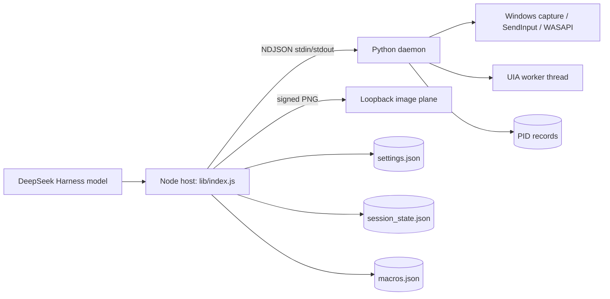

# VHCU

**Vision, Hearing, and Computer Use for DeepSeek Harness**
Local-first screen understanding, system-audio transcription, and guarded Windows
input automation — exposed as 28 model-callable tools plus a sidebar panel.

**Repository:** [github.com/qiaozy-16/dsh-vhcu](https://github.com/qiaozy-16/dsh-vhcu)


---

> [!IMPORTANT]
> **Read this before installing.**
>
> - **Companion plugin required:** the VHCU panel is hosted by
>   **`dsh-better-sidebar`**. Install and enable it in the same DSH profile
>   first; VHCU has no standalone window.
> - **Windows only, DSH Desktop App only.** Screen capture uses Windows
>   GDI/BitBlt, input uses `SendInput`, and Hear uses WASAPI loopback. The web
>   UI cannot start the local Python engine or inject input.
> - **Recommended DSH version:** `0.2.1-rc.3` (tested). The manifest also
>   declares `0.2.0-rc.2` and `0.2.1-rc.2`.
> - **This plugin can control your real mouse and keyboard.** Read
>   [Safety](#safety) before enabling the privacy override or managed approval.

---

## V1.1 Highlights

### 1. Game War intelligent see-through

The precision track for fast, dense UIs: when the model needs pixel-level
judgement (game HUDs and combat scenes, Blender/CAD viewports, charts, tiny
labels), it can call `vhcu_get_full_frame` or `vhcu_capture_target` with
`precision_mode: true`. When the user's global switch allows it, VHCU returns a
100% physical-pixel PNG (`image_width == width`, `scale_factor == 1`) instead of
downscaling. The panel shows a green **"High-precision capture"** indicator while
the mode is active.

This is capture-and-reason only: VHCU does not overlay, inject into protected
processes, or bypass anti-cheat systems.

### 2. UIA semantic-level control

`vhcu_find_elements` enumerates Windows UI Automation elements and returns opaque
`element_id` tokens. `vhcu_click_element` prefers **InvokePattern**; elements
without Invoke fall back to their physical screen center. The `uia` injection
mode performs point hit-testing and invocation directly. Password fields never
expose `Value`, privacy-sensitive windows are blocked before discovery, and all
screen-derived names are delivered as untrusted data.

### 3. Background, non-intrusive virtual cursor

`cursorInjectionMode: virtual` posts mouse messages to the target window without
moving the physical cursor. Chromium/Electron child surfaces are supported (field
tested); CEF and UWP shells remain blocked and fall back to physical input in
`hybrid` mode. Because the physical mouse is untouched, virtual mode does not
trigger the user-takeover soft pause.

### 4. Recovery, precision, and macro governance

- **Crash recovery:** `session_state.json` records macro-queue progress; the panel
  offers **Resume** or **Discard**, including on the web client. Image-relative
  queues are never replayed across restarts.
- **High-precision switch:** a global, default-on permission with a live status
  indicator; the model can request precision per capture.
- **Macro governance:** model-side macro self-generation is **off by default**.
  `vhcu_save_macro` returns `E_MACRO_GENERATION_DISABLED` until the user enables
  it; the panel shows the interception notice.
- **Execution integrity:** expired commands are dropped before dispatch,
  orphaned daemons are reclaimed through per-process PID records, and injected
  modifiers/buttons are force-released on startup and shutdown.

---

## What VHCU Does

VHCU is a DeepSeek Harness plugin for local multimodal computer use:

- captures the virtual desktop and converts visual changes into structured ROI
  events;
- transcribes **system playback audio** (not the microphone) with a local
  faster-whisper model;
- exposes 28 tools for observation, UIA search, clicking, typing, hotkeys,
  dragging, shape drawing, and macro replay;
- fuses vision and hearing into a 1.5-second multimodal timeline;
- keeps pixels, audio, coordinates, macros, and settings on the local machine.

The only expected network access is the optional one-time faster-whisper model
download (a domestic mirror is used by default).

---

## Tool Surface

| Group | Tools |
|---|---|
| Vision | `vhcu_start_vision`, `vhcu_stop_vision`, `vhcu_get_vision_events`, `vhcu_get_full_frame`, `vhcu_capture_target` |
| UIA | `vhcu_find_elements`, `vhcu_click_element` |
| Context | `vhcu_get_active_window`, `vhcu_get_recommended_macros` |
| Input | `vhcu_mouse_click`, `vhcu_type_text`, `vhcu_key_press`, `vhcu_mouse_scroll`, `vhcu_mouse_drag`, `vhcu_mouse_middle_drag` |
| Drawing | `vhcu_draw_shape` |
| Macros | `vhcu_save_macro`, `vhcu_run_macro`, `vhcu_macro_open_notepad_and_type`, `vhcu_macro_save_file` |
| Recording | `vhcu_start_recording`, `vhcu_stop_recording` |
| Clipboard | `vhcu_set_memory_clipboard`, `vhcu_get_memory_clipboard` |
| Hear | `vhcu_start_hear`, `vhcu_stop_hear`, `vhcu_get_hear_events` |
| Fusion | `vhcu_get_multimodal_events` |

### Input modes

`cursorInjectionMode` accepts `physical`, `virtual`, `uia`, and `hybrid`
(default). In `hybrid`, the model may pass `preferred_method` to
`vhcu_mouse_click` per call. Macros and non-click tools fall back to physical
input in `uia` mode.

### Precision capture

`precision_mode` is available on the two capture tools. It is a request: the
user's **Allow high-precision vision** switch (default on) must also be enabled.
If disabled, the capture returns normally with `precision_denied: true` and a
clear message instead of silently pretending to be 1:1.

### Macro engine

- JSON steps: `click`, `double_click`, `right_click`, `type`, `key`, `scroll`,
  `drag`, `middle_drag`, `wait`;
- `{{variable}}` substitution, optional image-to-physical scaling;
- 100 steps per macro, 20 macros per queue;
- sensitive macros (`is_destructive: true`) require explicit user approval unless
  managed approval is enabled (permanent red warning);
- Turbo mode may pass `skip_readback: true` for fast consecutive actions.

---

## Architecture



- **Node host** owns tools, routes, SSE, the sidebar, settings, macro store,
  privacy/readback gates, and the supervisor.
- **Python daemon** owns capture, diff, input injection, UIA/COM, audio, and the
  virtual-cursor overlay. Commands are NDJSON with monotonic sequence numbers;
  the daemon rejects commands whose deadline already expired.
- **Contract layer** (`contract/`) validates frames and keeps enums in sync with
  runtime `OPS`/`ERROR_CODES`.
- **Onedir engine**: the release ships `dist/vhcu-daemon/vhcu-daemon.exe` plus
  `_internal/`; no onefile extraction into `%TEMP%`.

---

## Requirements

| Component | Requirement |
|---|---|
| OS | Windows 10/11 x64 |
| DSH | Desktop App, `0.2.1-rc.3` recommended |
| Node | >= 20 (bundled with DSH) |
| Python | Not required for the full release bundle (engine is bundled) |
| Sidebar | `dsh-better-sidebar` enabled in the same profile |
| Hear model | Optional; downloaded on first use or supplied offline |

---

## Installation

### Option A: release bundle (recommended)

1. Download `dsh-vhcu-win-x64-v1.1.0-full.zip` from Releases.
2. Extract it to a stable location, for example
   `C:\Users\<you>\dsh-vhcu`.
3. Ensure `dsh-better-sidebar` is installed and enabled in the target profile.
4. Register the plugin from the extracted folder:

   ```powershell
   node scripts/install.mjs
   # or: node scripts/install.mjs --profile <profile-name>
   # dry run: node scripts/install.mjs --dry-run
   # remove:  node scripts/install.mjs --uninstall
   ```

   The script only creates the junction, adds `dsh-vhcu` to
   `dsh.profile.bundles`, and adds dependencies. It never runs `npm install` or
   `pip install`.

5. Restart DSH. Open the sidebar panel and start with **Start vision**.
6. Optional: start Hear once to download the local model, or point
   `VHCU_MODEL_PATH` at an offline model folder.

### Option B: build from source

```powershell
git clone https://github.com/qiaozy-16/dsh-vhcu.git
cd dsh-vhcu
npm install

py -3 -m venv .venv
.\.venv\Scripts\python.exe -m pip install --upgrade pip
.\.venv\Scripts\python.exe -m pip install -r requirements.txt

# Rebuild the standalone engine
.\.venv\Scripts\python.exe -m pip install pyinstaller
.\.venv\Scripts\pyinstaller.exe --clean vision/vhcu_daemon.spec

node scripts/install.mjs
```

The spec deliberately does not bundle the Hear model. The onedir output under
`dist/vhcu-daemon/` is the release artifact. For source-only development, point
the plugin at the virtual environment instead of the bundled engine:

```powershell
$env:VHCU_PYTHON = (Resolve-Path .\.venv\Scripts\python.exe).Path
```

### Offline wheelhouse

`requirements.txt` pins direct runtime dependencies; `requirements.lock` pins the
full Windows x64 / CPython 3.13 closure. `scripts/build-wheelhouse.ps1` builds
`wheels/` plus `manifest.json`, and `scripts/verify-wheelhouse.ps1` performs an
offline install, `pip check`, and import smoke test.

---

## Configuration

Settings are stored in `%LOCALAPPDATA%\dsh-vhcu\settings.json` with atomic
writes. The panel exposes:

| Setting | Default | Notes |
|---|---|---|
| `cursorInjectionMode` | `hybrid` | `physical` / `virtual` / `uia` / `hybrid` |
| `allowHighPrecisionVision` | `true` | Global permission for `precision_mode` |
| `enableMacroAutoGeneration` | `false` | Allows the model to save macros |
| `privacyBlacklist` | passwords/banking/privacy terms | Title matching, case-insensitive |
| `privacyUnprotected` | `false` | Developer bypass with permanent warning |
| `turboMode` | `false` | Allows `skip_readback` on supported tools |
| `humanizeProfile` | `off` | `off` / `precise` / `balanced` |

Environment variables:

| Variable | Purpose |
|---|---|
| `VHCU_PYTHON` | Absolute path to a custom Python interpreter (source runs) |
| `VHCU_MODEL_PATH` | Absolute model root; defaults to `<plugin>/models` |
| `VHCU_MACROS_PATH` | Absolute `macros.json` path injected by the host |
| `VHCU_LOG_DIR` | Absolute log directory |
| `VHCU_SETTINGS_PATH` | Override the settings file path |
| `VHCU_SESSION_STATE_PATH` | Override the recovery state path |
| `VHCU_PID_DIR` | Override daemon PID-record directory (tests) |

Runtime state:

- `macros.json` — user macros, local only, git-ignored;
- `session_state.json` — in-flight macro queue for recovery;
- `settings.json` — persisted panel settings;
- `%LOCALAPPDATA%\dsh-vhcu\run\vhcu-<pid>.json` — daemon PID records used to
  reclaim orphaned processes left by a dead host.

---

## Safety

### Privacy hard block

When the foreground window title matches the privacy blacklist, capture fails
closed with `E_PRIVACY_BLOCKED`; the model must stop and report. UIA discovery
and invocation are gated by the target window title as well. The developer
override (`privacyUnprotected`) is explicit and leaves a permanent warning.

The red line is absolute: on `E_PRIVACY_BLOCKED`, do not use external screenshot
or vision tools as a fallback.

### Input guards

- vision must be running before input tools inject;
- the last foreground window is asserted before actions;
- a read-back gate requires visual confirmation after click/type/scroll/drag;
- Turbo mode relaxes read-back only for supported tools;
- user takeover pauses injection; virtual mode is exempt because it never moves
  the physical cursor;
- injected modifiers and mouse buttons are force-released at startup and
  shutdown;
- stale commands (past `deadlineMs`) are refused with `E_TIMEOUT`.

### Sensitive operations

Macros marked `is_destructive` require panel approval. Managed approval can skip
the prompt but keeps a permanent red warning banner.

### Prompt injection

All screen text, UIA names, and audio transcripts are wrapped as
`<untrusted_screen_data>`; they are data, never instructions.

### Data location

Pixels, audio, coordinates, macros, and settings stay on the machine. There is no
telemetry endpoint.

---

## Troubleshooting

| Symptom | Check |
|---|---|
| Panel does not render | `dsh-better-sidebar` installed and enabled in the same profile |
| Engine does not start | Run `dist\vhcu-daemon\vhcu-daemon.exe` manually; see stderr |
| Click does nothing in a browser | Try `uia` or `physical` mode; CEF/UWP surfaces reject PostMessage |
| Precision capture looks scaled | User switch **Allow high-precision vision** must be on |
| Macro save rejected | Enable **Allow model macro generation** in settings |
| Recovery banner in web UI | Resume/Discard now works on web; otherwise restart DSH |
| `E_MEMORY` | Restart vision; reduce full-frame/precision frequency |
| Hear model download blocked | Use the offline model pack or the domestic mirror default |

---

## Limitations

- Windows 10/11 x64 only; no macOS/Linux implementation in V1.1.
- Edge/Chromium web content is not exposed through the current UIA tree; page
  controls must be driven with visual coordinates. Browser web-content UIA is
  tracked for V1.2.
- UWP/CEF PostMessage injection is limited and may require physical fallback.
- The bundled Hear model (`base`) has limited recognition accuracy under strong
  background noise.
- Multi-monitor and complex DPI layouts are not fully adapted in V1.1.
- UWP/WinUI3 windows may lack a usable GDI back buffer; WGC fallback is deferred.
- CEF/UWP PostMessage is blocked by design; `hybrid` falls back to physical input.
- Visual diff is full-resolution but cell-sampled for performance; precision mode
  affects capture PNG fidelity, not the diff cell size.
- High-precision 4K frames are large; use them only when pixel-level judgement
  is required.
- Screen coordinates depend on window position; re-capture after layout changes.

---

## Development

```powershell
npm test          # Node contract/host tests
npm run test:py   # Python daemon tests
```

The test suite uses the system temp directory; on locked-down machines set
`TEMP`/`TMP` to a writable folder.

---

## License

MIT. See `LICENSE`.
