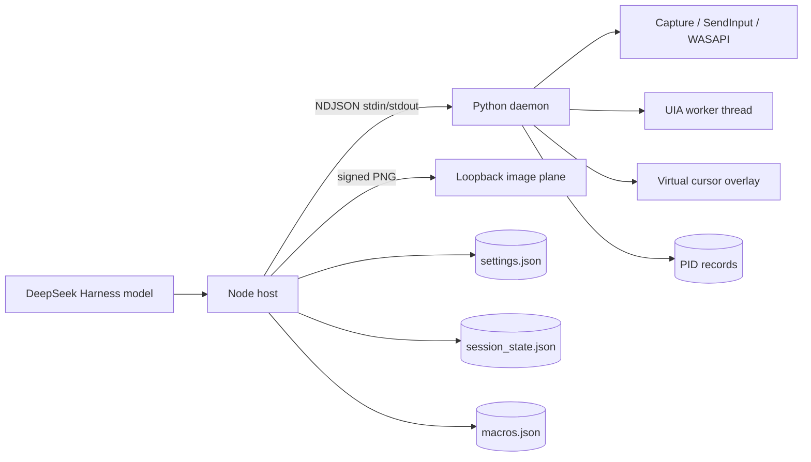

<p align="center"></p>

<p align="center">
  
  
  = 20">
  
</p>

# DSH-VHCU

A guarded, local-first multimodal Computer-Use Agent (CUA) for DeepSeek Harness.

DSH-VHCU gives DeepSeek Harness a guarded, local-first way to inspect the desktop,
understand the active window, transcribe system playback, and drive Windows input.
It exposes 28 model-callable tools and a sidebar panel; pixels, audio, macros,
coordinates, and settings stay on the machine.

**Scope:** Windows 10/11 x64, DSH Desktop App only.

## DSH Compatibility

VHCU is validated against a specific DSH Desktop release line. Patch releases
inside a verified line are expected to remain compatible, but every host upgrade
should still be smoke-tested because DSH evolves quickly.

| DSH Desktop line | Status | Notes |
|---|---|---|
| **0.2.2.x** | **Verified** | Smoke-tested on `0.2.2-rc.5`: tools, vision, UIA, capture, recording, browser and editor workflows |
| 0.2.1.x | Verified | Smoke-tested on `0.2.1-rc.3`; retained as the 1.1.x baseline |
| 0.2.0.x | Declared | Listed in `dsh.plugin.json`; not covered by the current smoke suite |
| Other / older | Unsupported | Host API drift is outside the support window |

Status meanings:

- **Verified** — the release line has been exercised on a real DSH Desktop host.
- **Declared** — the manifest allows the line, but no current end-to-end test covers it.
- **Unsupported** — the host API contract may have changed; install at your own risk.

DSH `0.2.2` and newer split the tool executor into
`dsh-tool-executor-native` (enabled by default) and `dsh-tool-executor-ptc`
(disabled by default). VHCU requires the native executor. Older `tools.mode`
configuration is no longer supported.

> DSH upgrades can reset a custom profile's bundle list. If the plugin appears
> disabled after an upgrade, re-enable `dsh-vhcu` and `dsh-better-sidebar` in
> the Plugins page (or restore `dsh.profile.bundles`) and restart DSH.

## Core Capabilities

### Vision and multimodal timeline

VHCU captures the virtual desktop, converts visual changes into structured ROI
events, and fuses them with loopback audio transcripts in a 1.5-second sliding
window. `vhcu_get_vision_events`, `vhcu_get_hear_events`, and
`vhcu_get_multimodal_events` expose the timeline without handing the model raw
screen pixels by default.

### UIA semantic clicking

`vhcu_find_elements` returns opaque element tokens with bounds, control type,
pattern availability, and stale fingerprints. `vhcu_click_element` prefers the
UIA InvokePattern and falls back to a verified physical center only when needed.
`uia` injection hit-tests the element under a point. `uiaDefaultDepth` is
configurable from 1 to 10 (default 6); a per-call `max_depth` overrides it.
Password fields never expose `Value`.

### Virtual cursor over PostMessage

`cursorInjectionMode: virtual` posts mouse messages to the target window instead
of moving the physical pointer. A layered, click-through overlay shows the
model's virtual cursor. `hybrid` is the default and can choose physical, virtual,
or UIA input per call, with a physical fallback for surfaces that reject posted
messages.

### Macro engine with breakpoint recovery and guardrails

Macros are local JSON step programs with `{{variable}}` substitution, optional
image-to-physical scaling, a 100-step cap, and a 20-macro queue cap.
`session_state.json` records queue progress so the panel can offer Resume or
Discard after a restart. Image-relative queues are never replayed across
restarts. Model-side macro self-generation is opt-in; without it,
`vhcu_save_macro` returns `E_MACRO_GENERATION_DISABLED`. Destructive macros
require explicit approval unless managed approval is enabled.

### High-precision mode

`vhcu_get_full_frame` and `vhcu_capture_target` accept `precision_mode: true`.
When the global **Allow high-precision vision** switch is enabled, VHCU returns
a 100% physical-pixel PNG (`image_width == width`, `scale_factor == 1`) and shows
a live high-precision indicator. If the switch is off, the call returns normally
with `precision_denied: true` instead of silently scaling.

### Image transport: URL or attachment

Some DSH builds cannot turn the signed `frame_url` into an image the model can
see, which leaves the model blind. VHCU therefore ships two transports,
selectable globally or per call:

- **`url` (default)** — the tool result embeds a short-lived signed URL. Cheapest
  in tokens; requires the host to fetch the URL.
- **`attachment`** — VHCU stores the PNG in the host attachment service and
  returns an `image` content block, so the model receives actual pixels. This is
  the same mechanism native vision plugins use.

Set `visionPayloadMode` in the settings panel, or pass
`payload_mode_override: 'url' | 'attachment'` on `vhcu_get_full_frame`,
`vhcu_capture_target` or `vhcu_get_vision_events` (the events tool attaches at
most three ROI images per call) to switch for one call.

Fallbacks, never a lost screenshot: a missing attachment service, a non-PNG
frame, a rejected store write, or a model route that declares no image input all
degrade to the signed URL and report `payload_mode_downgraded: true` with a hint.
An inline-base64 text track existed briefly and was removed: hosts treat the
data URI as text, truncate it, and the model still sees nothing.

### Attachment budget and the recycle bin

The host attachment store is append-only, content-addressed and shared with other
components; its own documentation says stored objects are never deleted
automatically, and the service exposes no delete or list API. VHCU therefore:

- keeps its own ledger (`attachments_registry.json`) of the attachments **it**
  created and only ever reclaims those ids;
- stops generating attachments at **2000 images or 500 MiB** (whichever comes
  first) and silently falls back to the signed URL;
- moves reclaimed files to the **OS recycle bin** (`shell.trashItem`, with a
  Windows `SendToRecycleBin` fallback) — never a permanent delete, so a user can
  restore them and antivirus does not see a data-destroying plugin;
- shows `Attachments: n/2000 · x/500 MB` in the panel, turns red near the cap and
  offers a one-click cleanup that keeps the newest 10% (at least one screenshot)
  and moves the rest to the recycle bin; below two attachments the button is
  disabled as "nothing to clean".

Cleaning can invalidate VHCU screenshots in older chat history — the UI says so
next to the button.

Screenshots stay lossless PNG on purpose. JPEG would cut the payload several
times over, but CUA depends on razor-sharp glyph edges for OCR and coordinate
picking; 449 KB per frame against a 500 MiB budget is a trade worth keeping. The
encoder picks a PNG filter per row and still uses RGB, no lossy step anywhere.

## Architecture



- **Node Host** owns tool schemas, sidebar routes, SSE, settings, macro storage,
  privacy/readback gates, and the daemon supervisor. It never captures the
  screen or injects input directly.
- **Python Daemon** owns capture, perceptual diff, `SendInput`, UIA/COM, WASAPI
  loopback, and the virtual-cursor overlay. The host talks to it over **NDJSON**
  on stdin/stdout, with monotonic sequence numbers and absolute deadlines.
- Frames are served by a loopback image plane through short-lived signed URLs.
- The release uses a PyInstaller **onedir** engine. There is no onefile
  extraction into `%TEMP%`; the Hear model is optional and not bundled.

## Installation

### For Users (Release Bundle)

**Requirements**

- Windows 10/11 x64.
- DSH Desktop 0.2.1-rc.3 or 0.2.2-rc.5 (0.2.2-rc.5 tested).
- Node.js 20+ on `PATH` (the installer is a Node script).
- `dsh-better-sidebar` installed and enabled in the same DSH profile.
- No separate Python installation is required: the release zip ships the
  PyInstaller **onedir** engine in `dist/vhcu-daemon/`.
- The Hear model is **not** bundled; download it on first use or set
  `VHCU_MODEL_PATH`.

**Steps**

1. Download `dsh-vhcu-v1.1.1.zip` from Releases.
2. Extract it to a stable folder, for example `C:\Users\<you>\dsh-vhcu`.
3. Install and enable `dsh-better-sidebar` in the same DSH profile.
4. From the extracted folder, register the plugin:

   ```powershell
   node scripts/install.mjs
   # optional profile: node scripts/install.mjs --profile <profile-name>
   # dry run:         node scripts/install.mjs --dry-run
   # remove:          node scripts/install.mjs --uninstall
   ```

5. Restart DSH and open the VHCU sidebar panel.
6. For Hear, start it once to download the local model, or point
   `VHCU_MODEL_PATH` at an offline faster-whisper model.

> The zip is a **DSH plugin bundle**, not a standalone application. There is no
> VHCU window or CLI that works without a running DSH Desktop host. Running
> `node scripts/install.mjs` only registers the plugin in a DSH profile; it does
> not start VHCU by itself. `node_modules/uiohook-napi` is included in the zip
> so macro recording works without a separate `npm install`.

### For Developers (Source Build)

```powershell
git clone https://github.com/qiaozy-16/dsh-vhcu.git
cd dsh-vhcu
npm install

py -3 -m venv .venv
.\.venv\Scripts\python.exe -m pip install --upgrade pip
.\.venv\Scripts\python.exe -m pip install -r requirements.txt
.\.venv\Scripts\python.exe -m pip install pyinstaller

.\.venv\Scripts\pyinstaller.exe --clean vision/vhcu_daemon.spec
node scripts/install.mjs
```

The spec does not bundle the Hear model. For source-only development, point the
plugin at the local interpreter instead of the bundled engine:

```powershell
$env:VHCU_PYTHON = (Resolve-Path .\.venv\Scripts\python.exe).Path
```

## Security & Privacy

- **Local-first.** No telemetry, no remote screenshot service, no cloud audio
  path. The optional Hear model download is the only expected network access.
- **Privacy hard block.** A blacklisted foreground title returns
  `E_PRIVACY_BLOCKED`; capture, UIA discovery, UIA invocation, and input all fail
  closed.
- **Password redaction.** UIA never reads password `Value`, and the model-facing
  renderer applies a second redaction guard.
- **Forced readback.** Click, type, scroll, and drag require visual confirmation
  before the next action. Turbo mode relaxes only explicitly supported tools.
- **Input guards.** Out-of-bounds coordinates are rejected or clamped; the
  foreground window is asserted before injection; the four screen corners act as
  an operator emergency stop.
- **Macro approval.** Destructive macros require approval unless managed approval
  is enabled, which keeps a persistent red warning.
- **Untrusted data.** Screen text, UIA names, and audio transcripts are wrapped
  as `<untrusted_screen_data>` and treated as data, never instructions.

## Known Limitations

- **Edge/Chromium web content is not exposed through the current UIA tree.**
  Page controls must use visual coordinates; browser web-content UIA is deferred
  to V1.2.
- **UWP/CEF PostMessage injection is limited.** Some surfaces reject posted
  messages; use `physical` or `hybrid` fallback.
- **Multi-monitor and complex DPI layouts are not fully validated in V1.1.**
- **The bundled Hear model (`base`) has limited accuracy under strong background
  noise.** Transcription still works, but word-level quality can degrade.
- **The four-corner emergency stop applies to the physical pointer.** `virtual`
  injection does not move the physical cursor, so a corner target will not trip
  that guard; use `physical`/`hybrid` when the stop gesture matters.
- **Macro recording requires a real desktop host.** It is unavailable in
  headless / `ELECTRON_RUN_AS_NODE` launches because the global `uiohook` hook
  receives no events there.
- Windows 10/11 x64 only; no macOS or Linux engine in V1.1.

## License

MIT. See `LICENSE`.
