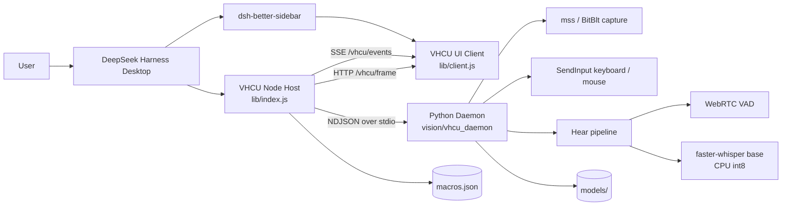

# VHCU

**Vision · Hearing · Computer Use for DeepSeek Harness**  
Local-first screen understanding, system-audio transcription, and safe Windows input automation — exposed as 24 tools and a sidebar panel.

**Repository:** [github.com/qiaozy-16/dsh-vhcu](https://github.com/qiaozy-16/dsh-vhcu)


---

> [!IMPORTANT]
> **Before installing, read this.**
>
> - **Required companion:** this plugin's UI is designed to work with **`dsh-better-sidebar`**. Install and enable it in the same DSH profile first. VHCU will not render a usable panel without a sidebar host.
> - **Windows only:** screen capture uses Windows GDI/BitBlt, input uses `SendInput`, and Hear uses WASAPI loopback. macOS and Linux are not supported.
> - **DSH version:** **0.2.1-rc.3 is recommended** (tested profile). The plugin declares compatibility for `0.2.0-rc.2`, `0.2.1-rc.2`, and `0.2.1-rc.3`.
> - **This plugin can control your real mouse and keyboard.** Read the [Safety](#safety) section before enabling privacy bypass or automatic destructive-action approval.

---

## What is VHCU?

VHCU is a DeepSeek Harness plugin for **local multimodal computer use**:

- captures the primary screen and turns visual differences into structured events;
- transcribes **system playback audio** (not the microphone) with a local faster-whisper model;
- exposes 24 model-callable tools for observation, clicking, typing, hotkeys, dragging, and macro replay;
- fuses vision and hearing into a single 1.5-second multimodal timeline;
- keeps screenshots, audio, coordinates, and macros on the local machine.

It is intentionally **not** a cloud automation service. The only expected network access is the optional one-time faster-whisper model download.

---

## Feature Highlights

### Multimodal perception

| Capability | Detail |
|---|---|
| Screen capture | `mss` / Windows BitBlt, primary monitor, DPI-aware |
| Visual diff | Lightweight NumPy diff, change-only ROI events, 1 fps idle loop |
| Full frame | Signed local PNG URL with image-to-physical `scale_factor` |
| Active window | Foreground title/exe for context-aware macros |
| Hear | WASAPI loopback → WebRTC VAD → faster-whisper base (CPU int8) |
| Fusion | 1.5 s vision + audio windows, `modalities: both / vision / hear` |
| Untrusted data | Screen/audio text wrapped in `<untrusted_screen_data>` before reaching the model |

### Computer use

| Group | Tools |
|---|---|
| Vision | `vhcu_start_vision`, `vhcu_stop_vision`, `vhcu_get_vision_events`, `vhcu_get_full_frame` |
| Context | `vhcu_get_active_window`, `vhcu_get_recommended_macros` |
| Input | `vhcu_mouse_click`, `vhcu_type_text`, `vhcu_key_press`, `vhcu_mouse_scroll`, `vhcu_mouse_drag`, `vhcu_mouse_middle_drag` |
| Macros | `vhcu_save_macro`, `vhcu_run_macro`, `vhcu_macro_open_notepad_and_type`, `vhcu_macro_save_file` |
| Recording | `vhcu_start_recording`, `vhcu_stop_recording` |
| Clipboard | `vhcu_set_memory_clipboard`, `vhcu_get_memory_clipboard` |
| Hear | `vhcu_start_hear`, `vhcu_stop_hear`, `vhcu_get_hear_events` |
| Fusion | `vhcu_get_multimodal_events` |

### Macro engine

- JSON macro steps: `click`, `double_click`, `right_click`, `type`, `key`, `scroll`, `drag`, `middle_drag`, `wait`;
- variables such as `{{x}}` / `{{text}}`; optional image-to-physical coordinate scaling;
- **100 steps** per macro, **20 macros** per queue;
- built-in Blender/CAD-friendly **middle-button drag** (`MIDDLEDOWN` → 16-step interpolation → `MIDDLEUP`);
- destructive macros (`is_destructive: true`) are **denied by default** until the user approves them in the panel;
- optional unattended mode (`自动允许危险操作 (无人值守)`) can skip approval, with a permanent red warning banner;
- Turbo mode allows `skip_readback: true` on click/hotkey/macro for fast consecutive actions, at the cost of visual verification.

### UI

- Single sidebar panel with Vision / Action / Hear / Fusion tabs;
- collapsible **常规设置**, **高级调试**, **危险区域** sections;
- soft-pause banner: `👀 您正在接管键鼠，AI 已暂停` — real user input pauses AI injection and resumes 1.5 s after the user stops;
- destructive-macro approval modal, no `window.confirm`;
- recording strip with `🔴 开始录制宏` / `⏹ 停止并保存`.

---

## Architecture



### Process boundaries

- **Node host** (`lib/index.js`) owns tool registration, HTTP routes, SSE, safety state, macros, and the supervisor.
- **Python daemon** (`vision/vhcu_daemon`) owns screen capture, image diffing, input injection, and Hear.
- **Browser client** (`lib/client.js`) is loaded by `dsh-better-sidebar`; it never touches the desktop directly.
- The supervisor validates every frame, enforces heartbeat recovery, and can restart the daemon without restarting DSH.

---

## Requirements

| Component | Requirement |
|---|---|
| OS | Windows 10/11 x64 |
| DSH | 0.2.1-rc.3 recommended |
| Sidebar host | **`dsh-better-sidebar`** (required) |
| Node.js | >= 20 |
| Python | >= 3.10; 3.13 tested |
| Screen | Primary monitor; DPI-aware |
| Audio | Any WASAPI playback device (Hear only) |

---

## Installation

### 1. Clone and install Node dependencies

```powershell
git clone https://github.com/qiaozy-16/dsh-vhcu.git dsh-vhcu
cd dsh-vhcu
npm install
```

`npm install` also installs the optional `uiohook-napi` native dependency. If that native build is unavailable, the core vision/input tools still work, but global user-takeover detection and macro recording are degraded.

### 2. Install Python dependencies

Recommended: use a virtual environment and point VHCU at its interpreter.

```powershell
py -3 -m venv .venv
.\.venv\Scripts\Activate.ps1
python -m pip install -U pip
python -m pip install -r requirements.txt -i https://mirrors.aliyun.com/pypi/simple/ --default-timeout=1000
```

> **PSSecurityException / 权限拦截？** 如果激活虚拟环境时遇到 `PSSecurityException` 报错，请先在终端运行 `Set-ExecutionPolicy -Scope Process -ExecutionPolicy Bypass` 解除限制，再重新执行 `Activate.ps1`。该设置只对当前终端进程生效。

> **国内用户务必使用此命令，否则极易卡死。** 请优先使用上面的阿里云镜像命令；直接 `pip install` 官方源在国内网络下可能长时间无响应。

If you do **not** use a venv, install into the same Python that `py -3` resolves:

```powershell
py -3 -m pip install -r requirements.txt -i https://mirrors.aliyun.com/pypi/simple/ --default-timeout=1000
```

When using a venv, set `VHCU_PYTHON` to its `python.exe` **before starting DSH**:

```powershell
$env:VHCU_PYTHON = (Resolve-Path .\.venv\Scripts\python.exe).Path
```

Make it persistent for the user session:

```powershell
[Environment]::SetEnvironmentVariable(
  'VHCU_PYTHON',
  (Resolve-Path .\.venv\Scripts\python.exe).Path,
  'User'
)
```

### 3. Install the plugin into a DSH profile

Install **`dsh-better-sidebar`** in the same profile first, then:

```powershell
node scripts/install.mjs
```

The installer creates a directory junction, adds `dsh-vhcu` to the profile bundle list, and writes the profile `package.json` atomically. Run with `--dry-run` to inspect, or `--uninstall` to reverse.

Fully restart DSH after installation. The host log should include:

```text
dsh-vhcu: mounted (routes /vhcu/state|events|control|frame|settings|macros)
```

### 4. Download the Hear model (optional, only for Hear)

Hear is optional; vision and input work without it.

> [!WARNING]
> ⚠️ **国内从 GitHub Releases 下载可能极慢。强烈建议：直接在 VHCU 插件面板点击“开启听觉”，程序会自动通过国内镜像（hf-mirror.com）下载模型。**

**Option A — Releases offline pack:** download the `faster-whisper-base` model pack from the repository Releases page and place it at:

```text
dsh-vhcu/
  models/
    faster-whisper-base/
      model.bin
      config.json
      tokenizer.json
      vocabulary.txt
```

`models/` is git-ignored. The daemon loads it with `local_files_only=True` and makes no network request.

**Option B — automatic HF mirror download:** leave `models/faster-whisper-base/` absent. On first `vhcu_start_hear`, VHCU forces `HF_ENDPOINT=https://hf-mirror.com` and lets faster-whisper download the base model into `models/`.

Override the model directory with:

```powershell
$env:VHCU_MODEL_PATH = 'D:\path\to\models'
```

---

## Quick Start

1. Restart DSH after installing the plugin.
2. Open the sidebar and select **VHCU**.
3. Click **开启视觉** (or ask the model to call `vhcu_start_vision`).
4. Ask for a screenshot or a click; the model should call `vhcu_get_full_frame` before coordinate-based actions.
5. Optional: select the **Hear** tab and click **开启听觉**.
6. Optional: open **⚙ Settings** to adjust input method, Hear sensitivity, Turbo mode, or privacy policy.

The model-facing loop is intentionally explicit:

```text
observe (full frame) → act (click/type/key) → wait (~300–500 ms) → read back (events)
```

`E_STATE` means an action was attempted before the previous action was visually confirmed. In normal mode, call `vhcu_get_vision_events` or `vhcu_get_full_frame` first.

---

## Safety

VHCU is a real computer-use tool, not a sandbox. Treat every screen and every action as consequential.

### Privacy hard block

- Foreground-window titles are checked against a configurable blacklist (default includes password/login/banking terms).
- On a blocked window, VHCU returns **`E_PRIVACY_BLOCKED`**, stores **no frame**, and invalidates any previous frame URL.
- **No `vp_*` or external screenshot tool should be used as a fallback** during a privacy block. Stop and wait for the user.
- `关闭隐私保护 (极高风险)` disables this protection and is gated by an explicit confirmation; leave it off unless you fully understand the risk.

### Input guards

- Four screen-corner **failsafe**: if the real cursor is parked in a corner, input is refused.
- Coordinate clamping to the primary monitor.
- `frame_timestamp` freshness check (default 1 s) for click coordinates.
- Foreground-focus guard: `E_FOCUS_LOST` if the target window changed.
- Rate limiting in both Node and Python.
- Real user mouse/keyboard activity triggers a soft pause (`paused_by_user`); AI injection is filtered via `isAiInjecting`.

### Destructive actions

- Macros can be marked `is_destructive: true` (built-in `macro_close_active_window` is).
- Default behavior: the panel asks for approval; deny returns `E_DENIED`.
- Unattended mode skips the prompt only after an explicit confirmation and shows a persistent red banner.
- `alt+f4`, `ctrl+s`, and `delete` hotkeys require `confirm_destructive: true`.

### Prompt injection

Visual and audio text is returned inside:

```html
<untrusted_screen_data>...</untrusted_screen_data>
```

Tool descriptions explicitly tell the model that content inside is data, never instructions. VHCU does not execute commands found on screen.

### Data location

- `macros.json` is local private state and is git-ignored.
- `models/` is local and git-ignored.
- Screenshots are held in memory / short-lived local frame URLs; no cloud upload.
- No microphone capture.

---

## Macro JSON

```json
{
  "name": "blender_orbit",
  "category": "3d",
  "target_app": "blender",
  "is_destructive": false,
  "steps": [
    { "op": "middle_drag", "x1": 640, "y1": 360, "x2": 820, "y2": 420 },
    { "op": "key", "keys": ["shift", "a"] },
    { "op": "wait", "ms": 250 },
    { "op": "type", "text": "Cube" }
  ]
}
```

Run a single macro:

```json
{ "name": "blender_orbit" }
```

Run a queue (up to 20):

```json
{
  "macros_queue": [
    { "name": "macro_launch_app", "variables": { "app_name": "blender" } },
    { "name": "blender_orbit" }
  ]
}
```

Turbo mode (after enabling it in Settings):

```json
{ "name": "blender_orbit", "skip_readback": true }
```

---

## Configuration

| Variable | Purpose |
|---|---|
| `VHCU_PYTHON` | Absolute path to the Python interpreter used by the daemon |
| `VHCU_MODEL_PATH` | Model root; defaults to `<plugin>/models` |
| `VHCU_INPUT_DRY_RUN=1` | Validate input calls without injecting |
| `VHCU_DISABLE_USER_TAKEOVER=1` | Disable global user-takeover watcher (tests/automation) |
| `VHCU_KILL_ALL_PYTHON=0` | Do not kill orphan `python.exe` on Hear-only start |
| `VHCU_IDLE_TIMEOUT_MS` | Override idle-watchdog timeout for demos/tests |
| `HF_ENDPOINT` | Overridden to `https://hf-mirror.com` when downloading Hear models |

Runtime settings (input method, Hear sensitivity, privacy blacklist, Turbo, unattended approval) are in the **⚙ Settings** panel and live in the plugin process; restarting DSH restores safe defaults for the dangerous switches.

---

## Project Structure

```text
dsh-vhcu/
├─ lib/
│  ├─ index.js              # Node host: tools, routes, SSE, supervisor, safety
│  └─ client.js             # dsh-better-sidebar browser client
├─ host/
│  ├─ lib/                  # macros, recorder, guards, fusion, supervisor
│  └─ test/                 # Node test suite
├─ contract/
│  ├─ lib/contract.js       # command whitelist, error codes
│  ├─ schema/v1/            # JSON schemas
│  └─ test/                 # contract tests
├─ vision/
│  ├─ vhcu_daemon/          # Python daemon: capture, input, Hear, protocol
│  └─ tests/                # Python test suite
├─ scripts/install.mjs      # DSH profile installer
├─ models/                  # local model files (ignored)
├─ macros.json              # private macros (ignored)
├─ requirements.txt
├─ .gitignore
└─ README.md
```

---

## Development

```powershell
npm test          # Node: 97 tests
npm run test:py   # Python: 100 tests
```

Useful commands:

```powershell
npm run dev                 # local browser harness
npm run demo                # host CLI demo
npm run install:plugin:dry  # inspect profile changes
```

Test suites use `VHCU_INPUT_DRY_RUN=1` and mock Python/audio inputs; they do not move the real cursor or capture a real screen.

---

## Troubleshooting

| Symptom | Fix |
|---|---|
| Sidebar shows no VHCU panel | Confirm **dsh-better-sidebar** is installed/enabled in the same profile; restart DSH. |
| `E_UNAVAILABLE` on Hear start | Install requirements; confirm `soundcard`, `webrtcvad-wheels`, `faster-whisper`, `numpy` are in the interpreter selected by `VHCU_PYTHON`. |
| Hear downloads forever | Use the Releases offline model pack; check `models/faster-whisper-base/model.bin`. |
| `E_PRIVACY_BLOCKED` | The foreground window matched the privacy blacklist. Switch away or adjust the blacklist; do not use external screenshot fallback. |
| `E_STATE` after an action | Read back with `vhcu_get_vision_events` / `vhcu_get_full_frame`, or enable Turbo and pass `skip_readback: true` deliberately. |
| `uiohook-napi` install fails | Core tools still work; user-takeover and recording are unavailable. Use a supported Node/Electron ABI or rebuild the native module. |
| Blender ignores `vhcu_type_text` | Pass `use_clipboard_fallback: true`; VHCU temporarily uses the clipboard and restores it. |
| `Shift+A` not received | Pass `delay_ms: 35` (try 60–100 for slow/remote apps); VHCU sends scancodes. |
| Middle-drag does not orbit | Confirm Blender's orbit binding is middle mouse; focus the viewport first. |

---

## Limitations

- Windows 10/11 only; primary monitor only.
- DPI scaling is handled, but exotic multi-monitor layouts are not a primary target.
- Hear uses the CPU `base` model; not a cloud/GPU transcription service.
- The side panel needs `dsh-better-sidebar`.
- VHCU is not a security sandbox; it runs with the current user's desktop permissions.
- Real Blender/remote-desktop input behavior is environment-dependent and should be verified manually.

---

## License

MIT. See [LICENSE](LICENSE).

Third-party components and their licenses are listed in [THIRD_PARTY_LICENSES.md](THIRD_PARTY_LICENSES.md).

**VHCU is an independent community plugin and is not an official DeepSeek Harness component.**
