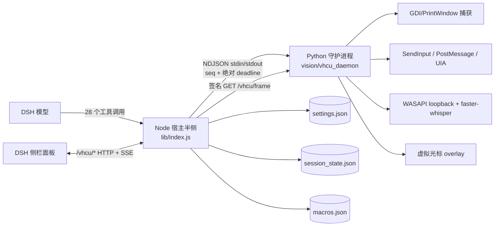

# 00 · dsh-vhcu v1.1 总览与阅读指南（宿主 0.2.2-rc5 适配前置调研）

- 调研时间：2026-11-22（Asia/Shanghai）
- 插件基线：`dsh-vhcu` v1.1.0（`package.json:4`）
- 当前运行宿主：DSH Desktop `0.2.1-rc.3`（`D:\deepseek-harness\resources\app-package.json`）
- 目标宿主：DSH `0.2.2-rc.5`（npm 与官方 nightly feed 均为该版本；安装包已下载到 `.tmp/dsh-022rc5/`，**未运行、未升级**）
- 本轮性质：**只读调研 + 方案设计**。未修改任何源码；`git status` 仅新增 `docs/`。
- 升级方式：宿主由用户手动升级；插件侧适配必须能先在 0.2.1-rc.3 上回归、再随升级验证 0.2.2-rc.5。

---

## 1. dsh-vhcu 是什么

一个**本地优先、按需唤醒**的 Windows 桌面 Computer-Use 插件，给 DSH 增加：

- 视觉：全屏/目标窗口截图、1 fps 差分 ROI、UIA 语义元素；
- 动作：物理注入 / PostMessage 虚拟注入 / UIA Invoke，键鼠、拖拽、滚轮、组合键、绘制曲线；
- 听觉：WASAPI 系统内录 + faster-whisper 本地转写；
- 编排：参数化宏、队列、断点恢复、录制、自生长；
- 面板：一个 betterSidebar tab，内含 Vision / Action / Hear / 融合 4 个数据 tab + 设置弹层。

对外契约的硬数字（以代码事实为准，**不是** README 的概数）：

| 项 | 事实 | 证据 |
|---|---|---|
| 模型可见工具 | **28 个** | `lib/index.js:3996-5393`；测试 `host/test/plugin.test.mjs:131-183` |
| Node 路由 | **10 条，全部 `kind:'exact'`** | `lib/index.js:1411-1752`；01 文档 §3 |
| Python 白名单 op | **27 个** | `contract/lib/contract.js:35-63`；03 文档 §2 |
| 宏容量 | **100 宏 / 100 步 / 40 分类**；队列 1..20 | `host/lib/macros.js`；01 文档 §7.3 |
| 输出 renderer | 通用 `TOOL_OUTPUT` + 4 个专用 | `lib/index.js:1768-1784`、`4223-4243`、`5339-5342`、`5374-5377` |
| Node 测试 | 28 个文件 / 206 个用例（2026-11-28 实跑 `npm test`） | 06 文档 §2；01 文档 §9 |
| Python 测试 | 258 个 test 函数（静态计数） | 03 文档 §6 |

> 注意三处与旧任务书/README 不一致，后续一律以代码为准：
> 1) 路由是 10 条不是 6 条；2) 宏上限是 100 宏/100 步不是 20 宏；3) 面板是 4 个数据 tab 不是 3 个。

---

## 2. 三层架构

| 层 | 职责 | 明确不做 |
|---|---|---|
| **Node 宿主半侧**（`lib/index.js` + `host/lib/`） | 28 工具 schema/execute、10 路由、SSE、设置/宏/断点、隐私与回读闸门、daemon Supervisor | 不直接截屏、不直接注入输入 |
| **Python 守护进程**（`vision/vhcu_daemon/`） | 捕获、差分、SendInput/PostMessage、UIA/COM、WASAPI、overlay、loopback 图像面 | 不感知 DSH 工具/会话语义 |
| **客户端半侧**（`lib/client.js`） | 单文件手工 CJS 模块；一个 betterSidebar tab 的 React 面板 | 不 import 任何 `@deepseek-ai/*` 客户端包，不用宿主 slot/主题/语言 API |

数据流有两条互不混用的通道：
- **控制面**：Node ↔ Python 的 NDJSON（stdin/stdout），带单调 seq 与绝对 deadline；stdout 被 Python 侧 dup 到 stderr，库的 print 不会污染帧流。
- **图像面**：PNG 不走 stdio。Python 在 127.0.0.1 开图像面，Node 签发**短时 HMAC URL** 的 `/vhcu/frame` 代理；模型与 `` 都只拿签名 URL。

---

## 3. 适配时不得破坏的 10 条不变式

这些是后续任何改动的“红线”，来自 01/02/03 三份调研：

1. **`apply()` 原子性**：apply 中任何未捕获异常会让 Cordis 卸载整个插件。路由注册没有 try/catch（`index.js:1755-1762`），工具注册逐项吞异常（`5531-5533`）。**不得在 apply 里探测可选 ctx 服务**；新增逻辑必须 fail-soft。
2. **按需唤醒**：挂载插件绝不 spawn Python；首次 `start` 才拉起（`index.js:1057-1074`）。
3. **隐私 fail-closed**：Python 侧黑名单前置拒绝；Node 侧 `state.privacy.blocked` 时帧路由 403。两层都要保留。
4. **先看后动 + 回读**：读事件/截图视为回读确认；动作后未回读，下一次动作 `E_STATE`；帧超过 `FRAME_MAX_AGE_MS` 拒绝点击。
5. **坐标系**：模型坐标是物理像素；`is_relative_to_image` 时按图片 `scale_factor` 与 `origin` 换算；`frame_timestamp` 绑定当次截图。
6. **宏状态机与持久化**：100 步/100 宏、队列 1..20、可恢复/致命错误分流、`session_state.json` 断点；图片坐标队列跨重启**丢弃**而非重放。
7. **帧签名**：Node HMAC-SHA256(`x|y|w|h|exp[|seq]`)、5 分钟 TTL、seq 绑定；PNG 带 `tEXt` 标记，工作区清理只认标记文件。
8. **不可信数据包裹**：屏幕文本/UIA 名称/转写文本一律 `<untrusted_screen_data>` 转义；工具生命周期 SSE 只发 name/callId/ok/code/durationMs，不发参数与结果。
9. **契约面固定**：28 工具名与 `parameters`(裸 JSON Schema)、`output{schema,render}`、4 个专用 renderer、工具描述前缀（优先 VHCU / 隐私阻断禁止兜底）都是模型行为的一部分，适配时不得顺手改名/删工具。
10. **卸载干净**：dispose 后不留 Python 子进程、SSE 定时器、uiohook 全局钩子、settings watcher；双通道 cleanup 幂等。

---

## 4. 状态与文件

路径由 `host/lib/paths.js:30-38` 决定：优先 `DSH_PROFILE_KEY → DSH_PROFILE → DSH_PROFILE_DIR` 做 profile 哈希隔离，缺省回退到用户数据目录下的共享 `dsh-vhcu`。

**本机实测（2026-11-28）**：状态实际落在 `%LOCALAPPDATA%\dsh-vhcu`（`settings.json` / `macros.json` / `run\`）。
`~/.dsh/vhcu` 下只有 island 相关文件，**不要把它当 VHCU 状态目录**。

| 文件 | 内容 | 写入策略 |
|---|---|---|
| `settings.json` | 15 个 UI 开关（隐私/托管/Turbo/高精度/宏生成等） | 字段级合并 + 原子替换 + 目录 `fs.watch` 跨窗口刷新（`host/lib/settings.js`） |
| `macros.json` | 内置宏 + 用户宏 + 分类 | 原子写；损坏隔离；100 宏/100 步/40 分类上限 |
| `session_state.json` | 宏队列断点（队列 id、index、items、options） | 每步前落盘，失败则不启动下一步 |

**已知现状（不是 0.2.2 引入）**：插件依赖 `DSH_PROFILE*` 环境变量，但本机实测进程环境未见这些变量，profile 隔离实际未命中，状态仍落在共享目录（见 2026-11-21 设置分叉修复记录）。适配阶段需把“宿主是否注入 profile 身份”作为一个显式验证项，不要假设。

---

## 5. 宿主 API 依赖（摘要，详见 01）

| API | 用法 | 失败后果 |
|---|---|---|
| `inject: ['webServer','tools']` | 入口服务声明 | 服务不足则不启用 |
| `ctx.tools.register(def)` | 28 次；def = name/description/parameters/output/execute | 逐项 try/catch → **静默少工具** |
| `ctx.on('tools/execute',(exec,next))` | 脚本写入拦截 | 签名/字段变化 → **安全静默失效** |
| `ctx.webServer.register({kind,path,handler})` | 10 条路由 | 抛错 → apply 中止 → 28 工具全卸载 |
| `ctx.webServer.getOrigin()/.origin/.port` | frame_url 绝对地址 | 全缺 → 相对 URL，模型侧链接失效 |
| `ctx.effect(body,name)` / `ctx.on('dispose')` | 清理 | 残留子进程/定时器/钩子 |
| `ctx.emit` / `ctx.logger` | 状态与生命周期事件 | 已 try/catch，非致命 |

客户端只依赖 4 项：`window.__ModuleLoader__.load({id,factory})`、平台 seed 的 `require('react')`、Cordis `ctx.betterSidebar.registerTab` / `ctx.effect`、同源 `/vhcu/*` 路由（详见 02）。

---

## 6. 兼容性适配的原则

1. **双宿主兼容优先**：目标是在 0.2.1-rc.3 与 0.2.2-rc.5 上都能挂载；用能力探测/字段回退，不按版本号硬分支。
2. **最小侵入**：先修“宿主契约已变/已错”的点，不做架构重构；28 工具名、路由、返回码、renderer、宏格式保持。
3. **失败可观测**：新增注册/适配逻辑不得再“静默吞掉”；至少结构化日志 + 状态字段。
4. **不改运行中的宿主**：验证 0.2.2 时使用解包到 `.tmp/` 的独立副本与独立 profile，不碰 `D:\deepseek-harness` 与用户当前 profile；真实升级由用户执行。
5. **每轮留痕**：工作日志写入工作区根目录（带时间戳 `.txt`），架构/差异结论写入本目录 `.md`。

---

## 7. 文档索引（本目录）

| 文件 | 内容 | 状态 |
|---|---|---|
| `00-总览与阅读指南.md` | 本文件：定位、架构、不变式、原则 | 完成 |
| `01-宿主半侧架构.md` | Node 宿主 5725 行 + 16 模块 + 10 路由 + 28 工具 + 生命周期/持久化/测试基线 | 完成（280 行） |
| `02-客户端半侧架构.md` | 单文件 CJS 模块、betterSidebar 契约、4 数据 tab、18 类调用映射、SSE 预算、0.2.2 断点 | 完成（386 行） |
| `03-Python守护进程架构.md` | NDJSON 协议、27 op、捕获/输入/UIA/Hear/overlay/图床、打包、错误码差异 | 完成（326 行） |
| `04-宿主0.2.2-rc5差异分析.md` | 0.2.1-rc.3 → 0.2.2-rc.5 逐 API 对比 + 20 行影响矩阵 + 断裂等级（P0=0 / P1=1 既有 / P2=4 / P3=15） | 完成（512 行 + 追加证据） |
| `05-兼容性适配工作方案.md` | 分阶段计划、变更清单、验证矩阵、风险登记、验收标准、进度快照 | 执行中（调研/基线/影子/真实升级完成，待发布） |
| `06-基线回归报告.md` | Node 206/206、Python 258/258、备份清单、环境与既有失败 | 完成 |
| `07-0.2.2安装包静态核对.md` | 0.2.2 安装包 asar 解出、版本/执行器/闸门/CUA 静态核对 | 完成（含影子启动与 TEMP 说明） |
| `08-真实0.2.2模型视角验收.md` | 真实 0.2.2 上 28 工具模型可见、视觉/UIA/录制实测结果 | 完成 |
| `99-证据与材料清单.md` | 环境基线、安装包/asar 哈希、npm 对照包路径、结论→证据索引、复现命令 | 完成 |

---

## 8. 证据等级约定

- 【码】直接读源码得到的事实；
- 【测】读测试得到的事实（不代表本轮执行过）；
- 【包】从 0.2.2-rc.5 npm 包/安装包解包得到的事实；
- 【推】推断，必须标注，不得当作结论。

本目录所有文档遵循同一约定。若后续发现与代码冲突，以代码 + 实机结果为准，并回写修订记录。
